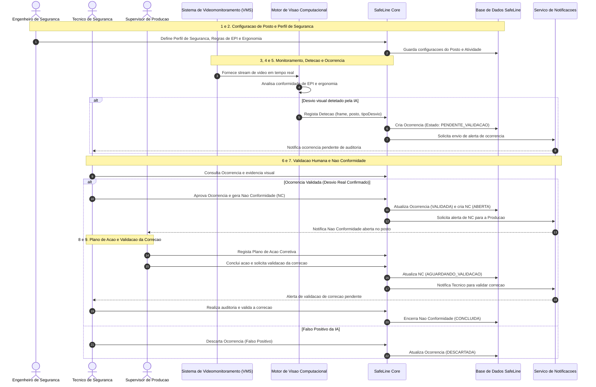
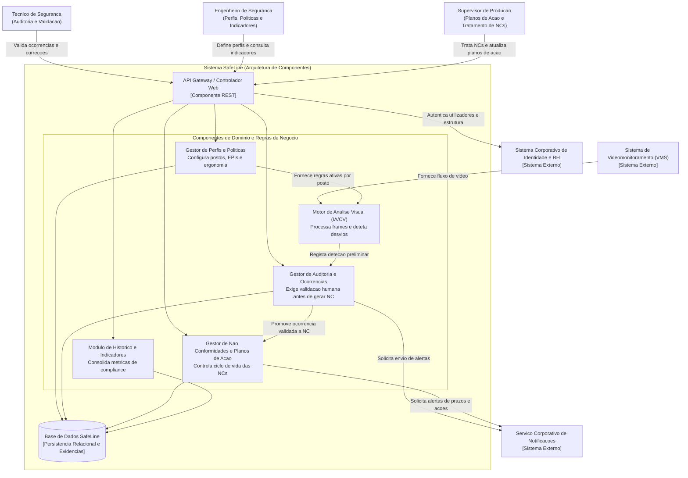
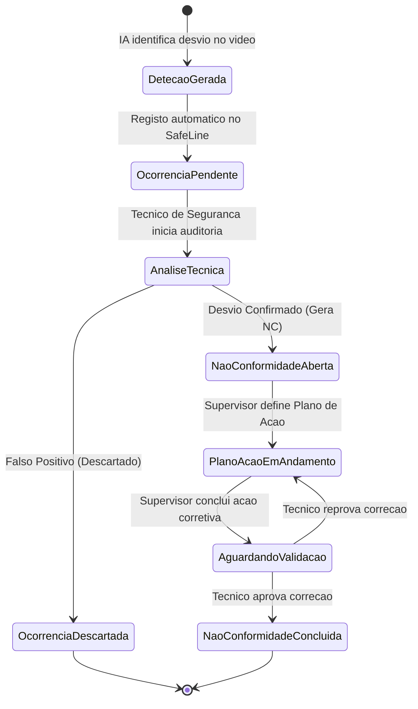
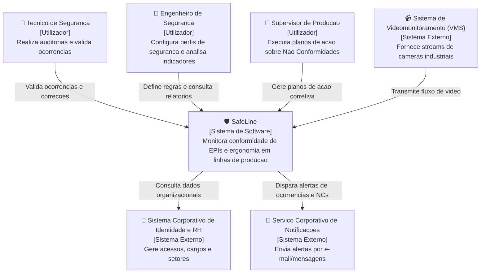

# SafeLine — Governança de Arquitetura e Modelagem (SGE2)
Repositório da Avaliação Final (SGE2) — Disciplina de Modelagem de Software | Sistema SafeLine

## 1. Diagrama de Sequência (Fluxo de Análise Visual e Tratamento de NC)

## 2. Diagrama de Componentes (Arquitetura Interna do SafeLine)

## 3. Diagrama de Estados (Ciclo de Vida da Deteção à Não Conformidade)

## 4. Diagrama C4 Nível 1 (Contexto do Sistema)

## 5. Auditoria de Arquitetura, Resiliência e ADR (Laboratório Agêntico)

Documentação gerada na auditoria arquitetural do **SafeLine**:

- **Passo 1 — Auditoria C4 Nível 2 (Contêineres):** [docs/architecture/01-auditoria-c4-nivel2.md](docs/architecture/01-auditoria-c4-nivel2.md)
- **Passo 2 — Diagrama de Sequência com Chaos e Resiliência:** [docs/architecture/02-sequencia-resiliencia-chaos.md](docs/architecture/02-sequencia-resiliencia-chaos.md)
- **Passo 3 — ADR 0001 (Mensageria Assíncrona e Resiliência):** [docs/adr/0001-escolha-tecnologica.md](docs/adr/0001-escolha-tecnologica.md)
- **Complemento — Desacoplamento por Interfaces e DI:** [docs/architecture/03-componentes-interfaces-di.md](docs/architecture/03-componentes-interfaces-di.md)

### Passo 4 — Checklist de Auditoria Final
- [x] **Consistência Nomes/Métodos:** Os nomes dos contêineres e serviços no C4 L2 (`Motor de Visao Computacional`, `Broker de Mensageria`, `API Gateway / SafeLine Core`, `Cache de Perfis e Sessoes`, `Base de Dados SafeLine`, `Worker de Notificacoes e Retentativas`, `Servico Corporativo de Notificacoes`) são exatamente os mesmos usados no Diagrama de Sequência.
- [x] **Sintaxe Compilável:** Todos os blocos Mermaid (`C4Container`, `sequenceDiagram`, `classDiagram`, `flowchart`, `stateDiagram-v2`) seguem sintaxe oficial compatível com GitHub e Mermaid Live Editor.
- [x] **Desacoplamento por Interfaces:** O Diagrama de Classes em `docs/architecture/03-componentes-interfaces-di.md` demonstra uso de interfaces (`IOcorrenciaService`, `IOcorrenciaRepository`, `INotificacaoPublisher`, `IPerfilCache`) e Injeção de Dependência via construtor.
- [x] **Rastreabilidade no Git:** Artefatos organizados em `/docs/architecture/` e `/docs/adr/`.
