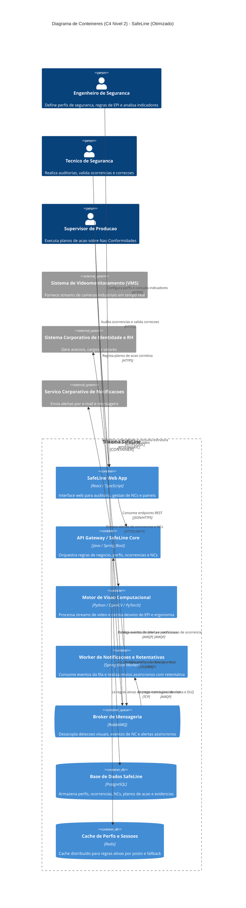

# Passo 1: Auditoria Agêntica do C4 Nível 2 (Contêineres) & Detecção de Gargalos

## Análise Arquitetural (Topologia SafeLine)

1. **Pontos de Falha Única (SPOF):** Na arquitetura inicial, o `SafeLine Core` concentrava todas as responsabilidades síncronas (API REST, ingestão de detecções de vídeo, persistência e disparo de alertas) conectado diretamente a uma única `Base de Dados SafeLine`, tornando o núcleo e o banco gargalos críticos em picos de detecção de câmeras.
2. **Acoplamento Síncrono Excessivo:** O `Motor de Visao Computacional` enviava detecções de forma síncrona para o núcleo, e o núcleo chamava diretamente o `Servico Corporativo de Notificacoes`. Qualquer lentidão na rede, no banco de dados ou indisponibilidade do serviço de e-mail bloqueava o processamento de frames em tempo real.
3. **Otimizações Aplicadas no C4 L2:**
   - Introdução de um **Broker de Mensageria (`RabbitMQ`)** para desacoplar a ingestão de detecções visuais e o envio de notificações.
   - Separação de um **Worker de Notificacoes e Retentativas** dedicado ao consumo assíncrono e tratamento de *Dead Letter Queue (DLQ)*.
   - Adição de um **Cache de Perfis e Sessoes (`Redis`)** para leitura de regras de EPI/ergonomia com baixa latência e suporte a *Circuit Breaker* / fallback.

---

## Diagrama C4 Nível 2 — Contêineres (Otimizado)

