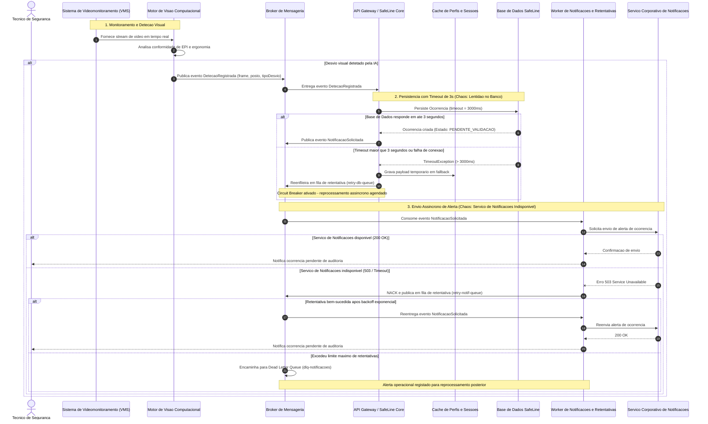

# Passo 2: Engenharia de Chaos e Resiliência no Diagrama de Sequência

Este diagrama evolui o fluxo principal do **SafeLine** (detecção visual de desvio de EPI/ergonomia, registro de ocorrência e envio de notificação) injetando cenários realistas de falha:
1. **Latência/Timeout na Base de Dados (`> 3s`)**: tratado com *Timeout*, *Circuit Breaker*, fallback em cache e reenfileiramento assíncrono.
2. **Indisponibilidade do Serviço Externo de Notificações**: tratado com retentativas assíncronas via mensageria (*backoff* exponencial) e *Dead Letter Queue (DLQ)*.

> Todos os nomes dos participantes correspondem exatamente aos contêineres e sistemas externos definidos no [Diagrama C4 Nível 2](01-auditoria-c4-nivel2.md).

