# Desacoplamento por Interfaces e Injeção de Dependência (SafeLine)

Este diagrama complementa a auditoria arquitetural demonstrando como o **API Gateway / SafeLine Core** e o **Worker de Notificacoes e Retentativas** aplicam o Princípio da Inversão de Dependência (DIP), utilizando **Interfaces** e **Injeção de Dependência (DI)** para isolar o domínio de detalhes de infraestrutura (PostgreSQL, Redis, RabbitMQ e Serviço de Notificações).

```mermaid
classDiagram
    class OcorrenciaController {
        -IOcorrenciaService ocorrenciaService
        +OcorrenciaController(IOcorrenciaService ocorrenciaService)
        +registrarDetecao(DetecaoDTO dto) ResponseEntity
        +validarOcorrencia(UUID id) ResponseEntity
    }

    class IOcorrenciaService {
        <<interface>>
        +processarDetecao(DetecaoDTO dto) Ocorrencia
        +validarOcorrencia(UUID id, boolean aprovada) void
    }

    class OcorrenciaServiceImpl {
        -IOcorrenciaRepository repository
        -INotificacaoPublisher publisher
        -IPerfilCache perfilCache
        +OcorrenciaServiceImpl(IOcorrenciaRepository repository, INotificacaoPublisher publisher, IPerfilCache perfilCache)
        +processarDetecao(DetecaoDTO dto) Ocorrencia
        +validarOcorrencia(UUID id, boolean aprovada) void
    }

    class IOcorrenciaRepository {
        <<interface>>
        +salvar(Ocorrencia ocorrencia) Ocorrencia
        +buscarPorId(UUID id) Optional~Ocorrencia~
    }

    class INotificacaoPublisher {
        <<interface>>
        +publicarAlerta(AlertaEvento evento) void
    }

    class IPerfilCache {
        <<interface>>
        +obterRegrasPosto(UUID postoId) Optional~PerfilSeguranca~
        +salvarFallbackOcorrencia(Ocorrencia ocorrencia) void
    }

    class PostgresOcorrenciaRepository {
        +salvar(Ocorrencia ocorrencia) Ocorrencia
        +buscarPorId(UUID id) Optional~Ocorrencia~
    }

    class RabbitMqNotificacaoPublisher {
        +publicarAlerta(AlertaEvento evento) void
    }

    class RedisPerfilCache {
        +obterRegrasPosto(UUID postoId) Optional~PerfilSeguranca~
        +salvarFallbackOcorrencia(Ocorrencia ocorrencia) void
    }

    OcorrenciaController --> IOcorrenciaService : injecao via construtor
    OcorrenciaServiceImpl ..|> IOcorrenciaService : implementa
    OcorrenciaServiceImpl --> IOcorrenciaRepository : injecao via construtor
    OcorrenciaServiceImpl --> INotificacaoPublisher : injecao via construtor
    OcorrenciaServiceImpl --> IPerfilCache : injecao via construtor

    PostgresOcorrenciaRepository ..|> IOcorrenciaRepository : implementa
    RabbitMqNotificacaoPublisher ..|> INotificacaoPublisher : implementa
    RedisPerfilCache ..|> IPerfilCache : implementa
```

