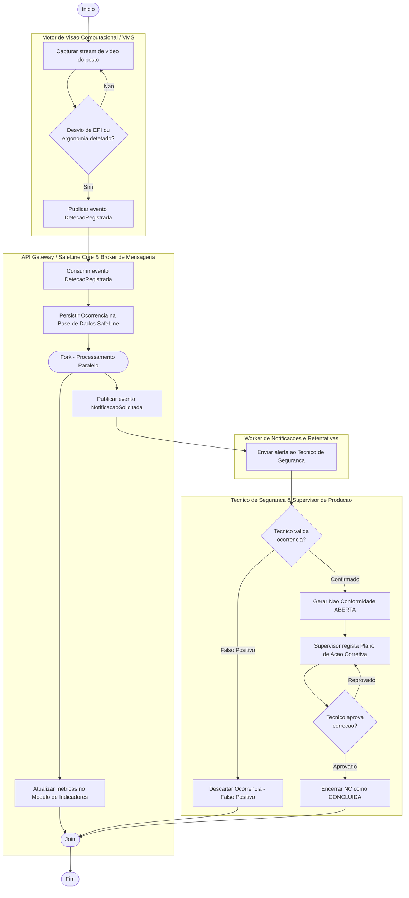
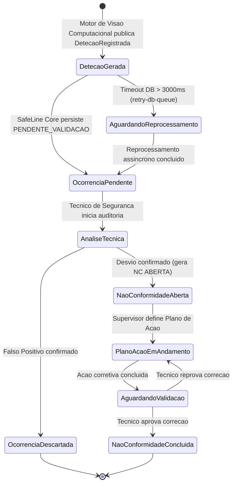

# Fluxo de Atividades e Máquina de Estados — Ciclo de Não Conformidade (SafeLine)

Este artefato complementa a modelagem comportamental do **SafeLine**, conectando os contêineres definidos no [Diagrama C4 Nível 2](01-auditoria-c4-nivel2.md) ao ciclo de vida completo de uma Ocorrência até o encerramento da Não Conformidade (NC).

## 1. Diagrama de Atividades com Raias e Fork/Join

---

## 2. Máquina de Estados (Ocorrência e Não Conformidade)

